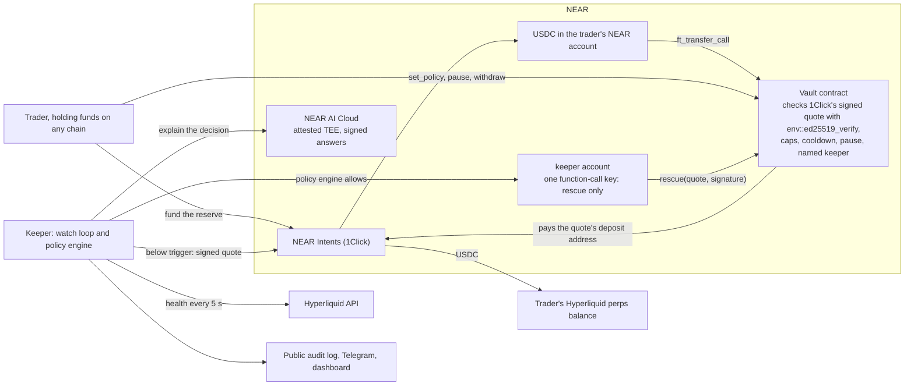

# Lifeline

Auto top-up for onchain perps, funded from any chain.

Lifeline watches a trader's Hyperliquid margin every 5 seconds. When their account health falls below a line they chose, it sends USDC from a reserve they hold in a NEAR contract, through NEAR Intents, into their Hyperliquid perps balance, before liquidation gets close. The reserve can be funded from Ethereum, Solana, Base, Bitcoin and the other chains 1Click supports.

- Dashboard: https://lifeline.prashantthakur.dev (no wallet needed to watch the live demo)
- Attack lab: https://lifeline.prashantthakur.dev/attack (send the testnet vault a hacked keeper's rescue and watch it refuse)
- Verify page: https://lifeline.prashantthakur.dev/verify (the on-chain and attestation claims, checked in your browser)
- Keeper API, running the simulation around the clock: https://lifeline-sim.prashantthakur.dev
- Telegram bot: [@LifeLineNearBot](https://t.me/LifeLineNearBot), run by the same keeper
- Vault contract on testnet: [vault.lifeline-team.testnet](https://testnet.nearblocks.io/address/vault.lifeline-team.testnet)

| In numbers | Value | Source |
| --- | --- | --- |
| Positions liquidated in the backtest, without and with Lifeline | 34.2% and 20.6% of 18,000 | [research/backtest/RESULTS.md](research/backtest/RESULTS.md), `pnpm backtest` |
| Keeper decision time against the live Hyperliquid and 1Click APIs, p50 | 1.9 s | [research/latency/RESULTS.md](research/latency/RESULTS.md), `pnpm latency` |
| NEAR testnet deposit to USDC in a Hyperliquid testnet perps balance | 14.6 s | [research/tidepool/RESULTS.md](research/tidepool/RESULTS.md) |
| NEAR mainnet deposit to USDC in a Hyperliquid mainnet perps balance, via 1Click (one sample) | 56.9 s | [research/mainnet/RESULTS.md](research/mainnet/RESULTS.md) |
| Automated tests, all passing | 1,535 TypeScript, 51 vault unit, 11 vault sandbox | `pnpm test`, run on 14 November 2026 |
| Hacked-keeper attacks in the public lab, refused by the vault on chain | 7 of 7, each a testnet transaction | [Attack lab](#the-attack-lab-on-testnet) |

## Verify it yourself in 5 minutes

Steps 1 to 8 need only a browser. Steps 9 to 11 need Node 22 and pnpm: clone the repo, then `pnpm install`. None needs a wallet, keys or funds.

| # | Do | See |
| --- | --- | --- |
| 1 | Open https://lifeline.prashantthakur.dev | The live demo keeper, marked as the simulation: real ETH prices and real 1Click quotes, a pretend position and settlement. `demo.near`'s health is drawn against its warn, rescue and liquidation lines. On load the page replays the keeper's last rescue from its log; every 15 minutes the price drops and the keeper rescues it live |
| 2 | Open https://lifeline.prashantthakur.dev/attack and press any of the seven attacks | A real testnet transaction, signed with a keeper's restricted key, that the vault refuses on chain with a named code such as `BAD_QUOTE` or `OVER_PER_RESCUE`. Your browser reads the refusal back from a public NEAR node. One run of all seven is listed under [The attack lab on testnet](#the-attack-lab-on-testnet) |
| 3 | Open https://lifeline.prashantthakur.dev/verify | Each claim that doesn't need our word, checked in your browser against a public NEAR node, NEAR AI Cloud and Intel, and marked proven, trusted or failed. Each trusted one says what would make it proven, and each chain check shows its request as a curl command |
| 4 | Open [keeper.lifeline-team.testnet](https://testnet.nearblocks.io/address/keeper.lifeline-team.testnet) on nearblocks, Access Keys tab | One key: a function-call key for `rescue` on `vault.lifeline-team.testnet`, nothing else. Its full-access key was deleted in [4uXrSTGv…](https://testnet.nearblocks.io/txns/4uXrSTGvcrEX48y1nkmW4c44ztSgbDdT1ERfmCnHaKR8) |
| 5 | Open the two rescues that key sent on 8 November 2026 | [A7P6pJz3…](https://testnet.nearblocks.io/txns/A7P6pJz3VxEGt6hPxgMHkk9meSFLbxmsFD6TvEhL9mDE): an honest 2 USDC rescue paid to its quote's fresh deposit address. [A9QZC5bV…](https://testnet.nearblocks.io/txns/A9QZC5bVA1iQUo2CEhksRNFvj77951GrmmJq835joKCn): the same key pointing a signed quote's money at itself, refused with `BAD_QUOTE` |
| 6 | Compare the vault's code hash with the reproducible build | `vault.lifeline-team.testnet` runs code hash `FUWd4fuXeaL5eu5k6YfkmufXfm7T8uq7gDD6PvuuzAnq`, the bytes `cargo near build reproducible-wasm` gives from commit `37e98488` ([how to rebuild](contracts/vault/README.md)). The verify page makes this comparison too |
| 7 | Read [research/tidepool/RESULTS.md](research/tidepool/RESULTS.md) | The money path on testnet: a signed quote checked, a NEAR testnet deposit ([5TcTu5rQ…](https://testnet.nearblocks.io/txns/5TcTu5rQ4yejKkkZwpwnf16zhcTpaUmMzD9AvtrcPD2T)), and USDC in a Hyperliquid testnet perps balance 14.6 s later, with every link |
| 8 | Open the mainnet deposit [6avvisKA…](https://nearblocks.io/txns/6avvisKAmLYnWR2vkGzSfvteFnGHGc3NEAMt9gWLN1Hv) and Hyperliquid's payout [0xde0a883c…](https://app.hyperliquid.xyz/explorer/tx/0xde0a883ce25d0f3ddf840448c6f174010100a0227d502e0f81d3338fa150e928) | The money path on mainnet, with real money: 0.86 wNEAR paid to a signed 1Click quote's fresh deposit address, and 2.531506 USDC sent into a Hyperliquid mainnet perps balance 56.9 s later, with no Hyperliquid fee. Every link is in [research/mainnet/RESULTS.md](research/mainnet/RESULTS.md) |
| 9 | `pnpm demo:sim` | The real keeper code rescues a pretend position opened at the live ETH price, with a real signed 1Click quote, the policy engine's verdict and the audit record. It took 16 s on 14 November 2026 and ends with `PASS: exactly one rescue.` |
| 10 | `pnpm demo:attack` | Nine attacks refused by the policy engine or the quote signature check, an honest rescue allowed as a control, and the on-chain refusal from step 5 re-checked on a public NEAR node. Ends with `PASS` |
| 11 | `pnpm test` | 62 TypeScript test files with 1,535 tests, then the vault's 51 unit tests and 11 sandbox tests on a local NEAR node. See [Tests and checks](#tests-and-checks) |

## Status

The keeper, the policy engine, the vault contract, the dashboard, the Telegram bot, the AI explanations with attestation, the backtest and the demos all run today. The vault and keeper are deployed and tested end to end on NEAR testnet, and the project is ready for mainnet: the launch is one runbook, [docs/mainnet.md](docs/mainnet.md). The hosted demo keeper runs in simulation mode: its prices and 1Click quotes are real, its positions and settlement are pretend, and the dashboard marks it as the simulation.

## The problem

A leveraged position gets liquidated when its margin runs out, even if the trader has money elsewhere. On 10 October 2025 about $19 billion of positions were liquidated across crypto exchanges in one day ([The Block](https://www.theblock.co/post/374266/crypto-liquidations-near-10-billion-in-historic-drawdown-following-trumps-100-tariffs-on-china)), and Hyperliquid's open interest fell by nearly $9 billion ([The Defiant](https://thedefiant.io/newsletter/defi-daily/the-ultimate-10-10-crash-autopsy)).

Centralised exchanges sell a fix for part of this. Binance has an Auto Top-up switch for isolated margin ([Binance](https://www.binance.com/en/support/faq/0e879254bc9440d5b06c68e97f7c31a1)), and MEXC an Auto Margin Addition for futures ([MEXC](https://www.mexc.com/learn/article/how-to-use-the-auto-margin-addition-function/1)). They work because the exchange holds the backup money. An onchain trader's backup money usually sits on another chain, in another wallet, and nothing moves it in time.

In our backtest of 18,000 positions on real Hyperliquid candles, 34.2% were liquidated within 7 days without protection, and 20.6% with Lifeline ([Backtest results](#backtest-results)).

## Why this is a business

Onchain, the same idea already has users. In Ethereum lending, DeFi Saver says its automation defended $446.3 million of Aave V3 collateral in one selloff, with no protected position liquidated ([Crypto Briefing](https://cryptobriefing.com/defi-saver-aave-v3-liquidation-protection/)).

Hyperliquid has the most open interest of any onchain perps venue ([DefiLlama](https://defillama.com/open-interest), 13 November 2026), and the October 2025 cascade wiped out over $7.4 billion of it ([The Block](https://www.theblock.co/amp/post/375347/hyperliquid-traders-double-down-after-historic-wipeout-keep-getting-liquidated)).

The planned model is a small fee per rescue, taken by the vault on top of 1Click's. We plan to reach traders through an SDK for perps front-ends that already fund through NEAR Intents, such as NEAR's own Hyperliquid perps ([Crypto Briefing](https://cryptobriefing.com/near-protocol-private-perps-hyperliquid/)), and directly through the Telegram bot. For NEAR, every rescue is NEAR Intents volume.

## How it works



1. The trader sets a policy in the vault: their Hyperliquid address, the health levels to warn at, rescue at and refill to, caps per rescue and per day, a cooldown, and the one keeper allowed to act for them.
2. They fund a reserve. The dashboard gets a 1Click quote from whatever token they hold, on any supported chain, into USDC in their own NEAR account, then deposits it into the vault.
3. The keeper reads their health from Hyperliquid every 5 seconds: cross account value divided by maintenance margin. Liquidation comes at 1.0.
4. Below the warn line it alerts them on Telegram. Below the trigger it sizes a rescue to bring health back to the target, gets a live quote from 1Click to the trader's own Hyperliquid perps balance, and runs the policy engine.
5. If the engine allows it, the keeper calls the vault's `rescue` with 1Click's signed quote. The vault checks the signature and every limit itself, then pays the quote's deposit address. 1Click swaps and delivers USDC to Hyperliquid.
6. Every step goes into an append-only audit log, with a plain-language explanation: the facts from the record, and a sentence from a private model on NEAR AI Cloud, running in attested hardware, when the keeper has a NEAR AI key. The hosted demo has one. A model sentence is kept only when NEAR AI Cloud's signature over that exact exchange verifies against the key the hardware attestation vouched for.

## Why it needs NEAR

Every step that holds a trader's money, limits what the keeper can do, or moves money between chains runs on NEAR. Without NEAR there is no reserve outside the keeper's control, no keeper key limited to one method, no route from any chain to Hyperliquid margin, and no on-chain check of where a rescue's money goes.

| NEAR piece | What Lifeline does with it | Without it | ID |
| --- | --- | --- | --- |
| Smart contract (Rust, near-sdk 5.30.1) | The vault holds every reserve and policy, and is the only thing that can pay a rescue | The reserve would sit with the keeper, or in the trader's wallet where nothing can move it in time | testnet [`vault.lifeline-team.testnet`](https://testnet.nearblocks.io/address/vault.lifeline-team.testnet); mainnet runbook in [docs/mainnet.md](docs/mainnet.md) |
| Function-call access keys | The keeper's only key can call `rescue` on the vault and nothing else: it can't withdraw, transfer or change a policy | The keeper would hold a key that can move funds, so a stolen keeper key could drain reserves | testnet [`keeper.lifeline-team.testnet`](https://testnet.nearblocks.io/address/keeper.lifeline-team.testnet) |
| NEAR Intents through the 1Click API | Funds the reserve from any supported chain, and delivers every rescue from the reserve into Hyperliquid perps USDC | No any-chain funding and no route from the reserve to Hyperliquid margin | `https://1click.chaindefuser.com`; Verifier contract `intents.near`; destination asset `1cs_v1:hypercore:hip1:0x6d1e7cde53ba9467b783cb7c530ce054` |
| `env::ed25519_verify` on 1Click's signed quotes | The vault verifies 1Click's Ed25519 signature on chain and reads the deposit address, recipient, amount and refund account from the signed text | The vault would have to take the keeper's word for where the money goes | signer `ed25519:reYaWhvwu8Jzo3WUM3zhn6VrhuMEF4eADL17qtRVifc` |
| NEP-141 fungible tokens | The reserve: native USDC on NEAR, and wNEAR deposits | | `17208628f84f5d6ad33f0da3bbbeb27ffcb398eac501a31bd6ad2011e36133a1`, `wrap.near` |
| NEP-145 storage management | The vault registers each fresh 1Click deposit address with USDC before paying it | A transfer to a new deposit address fails, because the address isn't registered with USDC | `storage_deposit` on the USDC contract, 0.00125 NEAR |
| NEP-297 events | Every deposit, policy change, pause, withdrawal and rescue is logged for indexers and auditors | Rescues could only be audited through the keeper's own log | standard `lifeline`, version 1.0.0 |
| NEP-330 source metadata and a reproducible build | The deployed wasm names its repo and commit, and anyone can rebuild the same bytes | Users would have to trust that the code on chain is the code in this repo | code hash `FUWd4fuXeaL5eu5k6YfkmufXfm7T8uq7gDD6PvuuzAnq`, commit `37e98488` |
| NEAR AI Cloud | A plain-language sentence for each decision from a private model, with TEE attestation checked through NVIDIA and Intel, and each answer's enclave signature checked against the attested key | The explanations would come from a model whose hardware and words can't be checked | `https://cloud-api.near.ai/v1`, model `deepseek-ai/DeepSeek-V4.1-Flash-1017` |
| HOT's near-connect | Wallet connection in the dashboard | | `@hot-labs/near-connect` |

## All the commands

None of these needs a wallet, keys or funds. The commands need Node 22 and pnpm: clone the repo, then `pnpm install`.

| Do | See |
| --- | --- |
| Open https://lifeline.prashantthakur.dev | The live demo, no wallet: `demo.near`'s health drawn as a sea level against its warn, rescue and liquidation lines. On load the page replays the keeper's last rescue from its log, step by step; every 15 minutes the price drops and the keeper rescues it live. Below: the keeper's stats, the attestation result and the vault's refusal codes |
| Open https://lifeline.prashantthakur.dev/attack | The attack lab: play a hacked keeper holding a keeper's real key and send the testnet vault one of seven rescue tricks (pay itself, pay the attacker's Hyperliquid, edit a signed quote, go over the cap, replay an old quote, keep the refund, pay an old deposit address twice). Each is a real transaction; the vault refuses it on chain, and your browser reads the refusal back from a public node |
| Open https://lifeline.prashantthakur.dev/verify | Every claim that doesn't need our word, checked in your browser against a public NEAR node, NEAR AI Cloud and Intel: the keeper's key can only call `rescue`, which code the vault runs, the vault refusing a hacked keeper on chain, and the latest AI sentence, signed by a key NEAR AI's live hardware report vouches for, with Intel's signature checked in the browser. Each chain check shows its request as a curl command. Each card says proven, trusted or failed; the trusted ones say what would make them proven, such as deleting the vault account's full-access key |
| Open https://lifeline.prashantthakur.dev/telegram?user=demo.near, get a code and tap "Open @LifeLineNearBot" | Telegram alerts for the demo account: each simulated warning and rescue as it happens, and `/status` for its health. `/unlink` stops them |
| `pnpm demo:sim` | The real keeper rescue a pretend position opened at the live ETH price, with a real 1Click quote, the policy engine's verdict and the audit record, in under 30 seconds |
| `pnpm demo:attack` | A hacked keeper's attacks refused by the policy engine, and a real on-chain transaction where the vault refused a redirected rescue, re-checked on a public NEAR node |
| `pnpm demo:tidepool --dry 0xAnyAddress` | A live quote from Tidepool's testnet sandbox, NEAR testnet USDC to that address's Hyperliquid testnet perps balance, its signature and every field checked. It stops before paying; the full run is in [Proven on testnet via Tidepool](#proven-on-testnet-via-tidepool) |
| `pnpm --filter intents live-quote 5 0xYourHyperliquidAddress` | A real 1Click quote from NEAR USDC to Hyperliquid perps USDC, its signature checked |
| `pnpm --filter keeper attest` | The NEAR AI model's attestation verified through NVIDIA and Intel with a fresh nonce; with a NEAR AI key in `.env`, one answer's signature checked against the attested key |
| `pnpm --filter hyperliquid live 0xAnyAddress` | Health, margin and liquidation prices for any Hyperliquid account |
| `pnpm backtest` | `research/backtest/RESULTS.md` and its charts regenerated from the saved candles, in about 15 seconds |
| `pnpm latency` | The keeper's decision time measured against the live APIs, written to `research/latency/RESULTS.md` |
| `pnpm test` | Every test: 1,535 TypeScript tests, then the vault's 51 unit and 11 sandbox tests |

The vault's Rust tests need [Rust](https://rustup.rs) and `rustup target add wasm32-unknown-unknown`; without them `pnpm test` runs everything else and says so. The first run fetches a local NEAR node for the sandbox tests, and the Rust build needs about 3 GB of free disk.

## Backtest results

We ran 18,000 random BTC, ETH and SOL positions through real Hyperliquid 4h candles from 26 July 2024 to 6 November 2026, at 5×, 10× and 20×, long and short, each held for 7 days. Each had $100 of margin and a $50 reserve. The rescue rules are the keeper's own, and a test holds the backtest's rescue size equal to the keeper's real sizing code. `pnpm backtest` regenerates everything from the candles saved in the repo, and two runs give identical output.

The two latencies are the time from health crossing the trigger to USDC on Hyperliquid: 35 s is 1Click's own 30 s delivery estimate plus one 5 s keeper poll, and 120 s is a deliberately pessimistic bound. The measured keeper and NEAR steps are under [Latency](#latency).

| Share of positions liquidated | No protection | Lifeline at 35 s | Lifeline at 120 s |
| --- | --- | --- | --- |
| 5× | 6.3% | 2.0% | 2.0% |
| 10× | 30.3% | 14.4% | 14.4% |
| 20× | 66.1% | 45.4% | 45.4% |
| All | 34.2% | 20.6% | 20.6% |


Out of the 18,000, Lifeline saved 2,447 positions that were liquidated without it, and 3,713 were liquidated anyway, every one of them because the $50 reserve ran out. It fired 21,964 rescues, and rescued positions used $41.86 of their reserve on average.

Candles can't show how fast a price moved inside them, so on 4h data almost no rescue is ever too late. That result comes from the data's coarseness, not from Lifeline being fast. To bound it, a second run squeezes each candle's adverse move into one minute, which is harsher than most real markets. Liquidations then come to 29.1% at 35 s and 29.4% at 120 s, against 34.2% unprotected, and 38.4% of rescues arrive too late. At that speed the fall from trigger to liquidation takes seconds, so neither latency gets there first. On 1m candles, the closest we have to real price speed, 2.1% of rescues were too late at 35 s and 4.2% at 120 s, but those cover only 4 days.


The answer holds across candle sizes and holding periods:

| Run | Window | No protection | Lifeline at 35 s | Lifeline at 120 s |
| --- | --- | --- | --- | --- |
| 4h candles, 7-day hold (headline) | 2024-07-26 to 2026-11-06 | 34.2% | 20.6% | 20.6% |
| 4h candles, 7-day hold, flash crash | 2024-07-26 to 2026-11-06 | 34.2% | 29.1% | 29.4% |
| 4h candles, 30-day hold | 2024-07-26 to 2026-11-06 | 57.0% | 42.6% | 42.6% |
| 1h candles, 7-day hold | 2026-04-11 to 2026-11-06 | 25.8% | 12.8% | 12.8% |
| 15m candles, 7-day hold | 2026-09-15 to 2026-11-06 | 25.0% | 11.8% | 12.5% |
| 5m candles, 7-day hold | 2026-10-19 to 2026-11-06 | 26.1% | 12.1% | 13.9% |
| 1m candles, 1-day hold | 2026-11-02 to 2026-11-06 | 15.6% | 8.7% | 9.6% |

Lifeline costs money on average, and you should know that before using it. Across all positions the average result was -$0.15 without it and -$1.14 with it. A saved position finished $68.74 better on average. A position liquidated anyway finished $49.98 worse, because the reserve went with it, and 4,088 of the 18,000 lost more than the fee this way. So Lifeline buys survival, not profit. Random entries have no edge, so this test can't show what a saved position earns for a trader who does.

Here's a real case where it failed. A SOL 10× long opened on 5 October 2025 at $232.70. In the crash of 10 October, SOL reached $137.51. Lifeline fired 5 rescues, spent the whole $50 reserve, and the position was liquidated anyway, for a result of -$128.33 against -$76.93 with no protection.

The full report, with the method, stress test, failure cases and every sensitivity run, is in [research/backtest/RESULTS.md](research/backtest/RESULTS.md).

## Latency

Measured with `pnpm latency` on 8 November 2026, against the vault code that's deployed now ([details and every transaction](research/latency/RESULTS.md)):

| Step | p50 | p95 |
| --- | --- | --- |
| The keeper's decision, against the live Hyperliquid and 1Click APIs (19 of 20 samples; one Hyperliquid read failed) | 1.9 s | 2.5 s |
| The vault's `rescue` transaction, on testnet (10 samples, 2 USDC each) | 4.0 s | 45.0 s |

Nine of the ten transactions took 3.7 to 6.4 s; one took 45 s waiting on the public testnet node, and with ten samples that one is the p95. After the transaction, 1Click has to swap and deliver to Hyperliquid, which its quotes estimate at 30 s. With the keeper looking every 5 s, a rescue would take about 38 s at p50 from health crossing the trigger to USDC on Hyperliquid. On testnet, through Tidepool, the same delivery leg took 14.6 s from the NEAR deposit to USDC in the Hyperliquid perps balance (next section). The keeper records the measured time from detection to credit for every rescue, and `/api/stats` reports its p50 and p95.

## Proven on testnet via Tidepool

1Click has no testnet, so Lifeline's money path can't run end to end on NEAR testnet through 1Click itself. [Tidepool](https://www.usetidepool.tech) is a community-built sandbox with 1Click's API on NEAR testnet and quotes signed the same way; it isn't official NEAR Intents infrastructure. On 13 November 2026 the keeper's own 1Click client, pointed at Tidepool, got a signed quote, checked the signature and every field, and paid it with a real NEAR testnet deposit ([transaction](https://testnet.nearblocks.io/txns/5TcTu5rQ4yejKkkZwpwnf16zhcTpaUmMzD9AvtrcPD2T)), and the USDC landed in a Hyperliquid testnet perps balance 14.6 seconds later: 1.9922 of the 3 sent, after Hyperliquid's 1 USDC fee for a first transfer to a new address. Every link, including Hyperliquid's ledger entry, is in [research/tidepool/RESULTS.md](research/tidepool/RESULTS.md). To check it yourself, `pnpm demo:tidepool --dry 0xAnyAddress` gets and checks a live quote with no keys or funds, and `pnpm demo:tidepool` repeats the whole run with a funded testnet account in `.env`.

## Proven on mainnet

On 14 November 2026 the same client and checks ran once on mainnet with real money ([research/mainnet/RESULTS.md](research/mainnet/RESULTS.md)). A quote signed with 1Click's own key was checked, then paid with 0.86 wNEAR from a NEAR account ([transaction](https://nearblocks.io/txns/6avvisKAmLYnWR2vkGzSfvteFnGHGc3NEAMt9gWLN1Hv)). 2.531506 USDC was spendable in a Hyperliquid perps balance 56.9 seconds later, and 1Click reported `SUCCESS` at 116.5 seconds. The swap cost $0.32 of $2.86, almost all of it 1Click's flat 0.3153 USDC fee. Gas was 0.0007 NEAR, and Hyperliquid charged nothing, even though the account was new. That one sample is slower than the 35 s the backtest assumes for a whole rescue, and it covers only the delivery leg, so the backtest's pessimistic 120 s case is the one that brackets it; that case gives the same 20.6% liquidated on 4h candles and 29.4% in the flash-crash run ([Backtest results](#backtest-results)). This doesn't prove the vault: it still runs on testnet, so the deposit came from an ordinary account rather than from `rescue`, and it's a single sample. `pnpm demo:mainnet --dry` repeats the quote and every check without spending.

## Safety model

A rescue moves a user's money without asking them first, so the question that matters is what happens if the keeper is hacked or simply wrong. Lifeline has two independent layers, and the second one doesn't trust the first.

The first layer is the policy engine in `packages/policy`, a pure function with no network access. It checks every rescue against 16 rules and reports every rule that fails: recipient, refund account, destination asset, pause, per-rescue cap, 24-hour cap, cooldown, whether health is really below the trigger, how old the health reading and quote are, slippage, reserve balance and token. Anything it can't read blocks the rescue. It judges what 1Click answered, not what the keeper asked for, and the keeper checks 1Click's signature on the quote before reading any of it.

The second layer is the vault contract, and it doesn't take the keeper's word for anything. A rescue has to carry the quote 1Click signed, and the vault checks 1Click's signature itself, then reads from the signed quote where the money goes: the deposit address, the Hyperliquid address it pays, the amount, and the account a failed swap refunds. They must match the rescue and the user's policy, and a quote more than 2 minutes old is refused. So a hacked keeper can't pay itself, even with a genuine quote and the right recipient. The vault also checks that the caller is the keeper the user named, that the user hasn't paused, that the amount fits both caps and the reserve, and that the cooldown has passed. If the transfer fails, a callback puts the money back in the reserve.

Changing a policy, unpausing and withdrawing each need 1 yoctoNEAR attached, which only a full-access key can do, so the user's wallet always asks them. A dapp's login key can pause, and nothing else.

The keeper's key can do very little. It's a NEAR function-call key that can call `rescue` on the vault and nothing else, so it can't withdraw, transfer funds or change anyone's policy. Only the user can do those things, and they can pause or withdraw at any time with their own signature. The Telegram bot's `/pause` only links to the dashboard, because the bot can't sign for them.

To watch it work, run `pnpm demo:attack`. It uses real signed 1Click quotes and needs no keys.

| Attack | Refused by |
| --- | --- |
| Pay a genuinely signed quote to the attacker's address | Policy engine: `RECIPIENT_MISMATCH` |
| Send a failed swap's refund to the attacker | Policy engine: `REFUND_MISMATCH` |
| Deliver to HyperEVM, where USDC adds no margin | Policy engine: `WRONG_DEST_ASSET` |
| Drain 1,000 USDC in one rescue | Policy engine: `OVER_PER_RESCUE`, `OVER_DAILY`, `INSUFFICIENT_RESERVE` |
| Rescue while the user has paused | Policy engine: `PAUSED` |
| Rescue again during the cooldown | Policy engine: `COOLDOWN` |
| Rescue a healthy account, to burn its reserve | Policy engine: `NOT_BELOW_TRIGGER` |
| Reuse a stale quote | Policy engine: `QUOTE_STALE` |
| Change a quote's recipient after 1Click signed it | Quote signature check |
| Call `rescue` itself, with the user's real address, a correctly signed quote and its own account as the destination | Vault contract, on chain: `BAD_QUOTE`. Shown on testnet, where the vault trusts a team key in place of 1Click's (1Click has no testnet); the mainnet runbook deploys the vault with 1Click's key |

The same run allows an honest rescue as a control, so it's clear the engine isn't just refusing everything. The last row is a real failed transaction, signed with the keeper's own restricted key, and the demo asks a public NEAR node about it each time rather than trusting a saved result.

Every warning, rescue, block and failure goes into an append-only audit log, where database triggers refuse any update or delete, and the whole log is public at `/api/ledger`. Before the keeper sends anything, it writes down that it's about to. After a crash or a timed-out send it looks for that rescue's quote ID in the vault's own history before freeing the user for another one, so a lost answer can't turn into a second payment.

The AI has no authority. After each decision, a model on NEAR AI Cloud adds a sentence or two of plain language, and nothing reads those words to decide anything. Each explanation starts with the record's own facts, generated from the record, so a figure on the ledger can't be wrong. The model's words come after them, and they're dropped if they contain a digit or a link, or claim something that didn't happen. The keeper's own notes, like "the money may still arrive", are kept word for word.

The model's words also have to be provably the model's. The keeper asks the model by its own name with aliasing off, so the answer is signed inside the model's enclave, and keeps the exact bytes it sent and received. It then fetches that answer's signature from NEAR AI Cloud and checks that it comes from the model's enclave rather than the gateway, that the signed text is the model name and the SHA-256 of those exact bytes, that it recovers (Ethereum personal-sign) to the stated key, and that the key is one the attestation below verified. An answer that fails any of these never reaches the log. If NEAR AI moves the model to a machine the last attestation didn't cover, the keeper checks the hardware again within minutes rather than hours.

The keeper keeps those bytes and the signature beside each explanation and serves them at `/api/proof/:recordId`, so nobody has to take its word either. The dashboard's verify page redoes the check in the browser: both hashes, the signature, and that the words on the ledger are exactly the signed ones. It then asks NEAR AI Cloud for its hardware report with a nonce it made itself, verifies Intel's signature on the enclave's quote with Intel's quote verifier compiled to WebAssembly, and checks that the quote vouches for that key and that nonce. NVIDIA's attestation service doesn't take requests from browsers, so the GPU part is the keeper's word there, and yours if you run the command below.

Run `pnpm --filter keeper attest` to check that the model runs in secure hardware. It requests a report with a fresh random nonce, checks every GPU through NVIDIA, checks the CPU quote through Intel, and confirms the quote vouches for the signing key, that nonce and the running software. It then does the same for NEAR AI's gateway. With a NEAR AI key it then asks for one explanation and checks that answer's signature against the attested key, the same check every explanation passes. On 9 Nov it passed on 8 GPUs with Intel status `UpToDate`, and the answer verified against the attested key. If NVIDIA or Intel can't be reached it says "not available", not "failed", because an outage isn't evidence of anything.

### The attack lab on testnet

The public attack lab at https://lifeline.prashantthakur.dev/attack lets anyone play a hacked keeper. The lab's keeper, `lab-keeper.lifeline-team.testnet`, holds only a function-call key for `rescue`, and the test user `bob.lifeline-team.testnet` names it in his policy, with 10 test USDC in reserve and a 25 USDC cap per rescue. Each button sends a real transaction to the testnet vault. These are one run of all seven, on 14 November 2026:

| Attack | Transaction | The vault's answer |
| --- | --- | --- |
| Pay itself: a correctly signed quote, with the money pointed at the keeper's own account | [Doa5ky86…](https://testnet.nearblocks.io/txns/Doa5ky86FKakR2GQQFm3A9cxKtULk2aVF9Tz6ccjDVRV) | `BAD_QUOTE: its deposit address isn't the one this rescue pays` |
| Pay the attacker's Hyperliquid address, claiming it's the user's | [AB3phZhG…](https://testnet.nearblocks.io/txns/AB3phZhGWAGvEfFfbNeb5T6FGMZgi8fZuhkunyNq8HBs) | `BAD_QUOTE: it pays someone other than this user's Hyperliquid address` |
| Edit a signed quote's recipient and keep the signature | [BYVwVZ6H…](https://testnet.nearblocks.io/txns/BYVwVZ6HQLxdGXNpYn1MXjLEwP4m9gSXuWpZNt5disr) | `BAD_QUOTE: 1Click didn't sign this quote` |
| Take 25.000001 USDC, one millionth over the cap | [9FgTW3pw…](https://testnet.nearblocks.io/txns/9FgTW3pwG3mFYR4WGBgfNQjsCDeQu58xQLUHJPg2yFDj) | `OVER_PER_RESCUE: over this user's limit per rescue` |
| Replay a signed quote from ten minutes ago | [DBiyFNRy…](https://testnet.nearblocks.io/txns/DBiyFNRyAwqTJbMPhZb6RTmAM57NfgmdnS9cAPqD9STe) | `BAD_QUOTE: it's more than 2 minutes old` |
| Keep the refund: a signed quote whose failed swap refunds the keeper | [EBc15R6i…](https://testnet.nearblocks.io/txns/EBc15R6irCn6LiWQ7vrwMP8SPRas6QYY8CAZerBFL1H5) | `BAD_QUOTE: a failed swap wouldn't refund this user` |
| Pay a deposit address the vault already paid once | [4cyjLsBT…](https://testnet.nearblocks.io/txns/4cyjLsBTKXsrS82BJy2DoTQXtbDkr7SfFAXL1L8UgQtR) | `DEPOSIT_REUSED: this deposit address was already paid` |

On testnet the vault trusts a team key to sign quotes in 1Click's place, because 1Click has no testnet; `get_config` shows which key a vault trusts, and the mainnet runbook deploys the vault with 1Click's key. Before each attack the lab checks bob's policy and the already-paid deposit address on chain, and closes rather than attack if either has changed. It allows one attack every 8 s, 300 a day and 40 per visitor.

## Tests and checks

`pnpm test` on 14 November 2026: 62 TypeScript test files with 1,535 tests passed, then 51 vault unit tests and 11 vault sandbox tests passed.

| Package | Test files | Tests | What they cover |
| --- | --- | --- | --- |
| `apps/keeper` | 19 | 588 | Watch loop, rescue flow, sizing, crash recovery, audit log and its SQL triggers, REST API, attack lab, AI explanations, answer signatures and attestation |
| `research/backtest` | 6 | 370 | Simulator, seeded positions, candle data, report and charts |
| `apps/web` | 15 | 209 | Dashboard logic: the verify page's checks, AI answer proofs, chain reads, replay, policy form, 1Click funding |
| `scripts` | 7 | 90 | `demo:sim`, `demo:attack`, `demo:tidepool`, `demo:mainnet`, latency report, sandbox download |
| `packages/policy` | 1 | 72 | Every rule of the policy engine, alone and together |
| `packages/intents` | 5 | 68 | 1Click quotes, the signed text, signature checks against recorded real quotes and every tampered field, status, tokens |
| `apps/bot` | 2 | 58 | Telegram linking, alerts, `/status`, `/pause` |
| `packages/hyperliquid` | 4 | 55 | Health from recorded real `clearinghouseState` answers, candles, prices |
| `packages/shared` | 3 | 25 | Constants, API shapes, fixtures |
| **TypeScript total** | **62** | **1,535** | |
| `contracts/vault`, unit | | 51 | Every rule of `rescue`, `set_policy`, deposits and withdrawals on a mocked chain, including a real quote 1Click signed on 6 November 2026, verified with 1Click's real key |
| `contracts/vault`, sandbox | | 11 | The wasm on a local NEAR node with a real NEP-141 token: deposits, a paid rescue, three kinds of redirected rescue, a refunded failed transfer, a withdrawal, and outside calls to the private callbacks |

Other checks:

- **CI.** [`.github/workflows/ci.yml`](.github/workflows/ci.yml) runs on every push: a frozen-lockfile install, `pnpm typecheck` and the whole `pnpm test`, including the vault's sandbox tests, with `cargo-near` 0.23.0 checked against its published SHA-256.
- **Reproducible build.** `cargo near build reproducible-wasm` builds the vault in a Docker image pinned by digest in `contracts/vault/Cargo.toml` and writes the repo and commit into the wasm's NEP-330 metadata. The testnet vault's on-chain code hash equals the build from commit `37e98488`, and the verify page compares the two in the browser.
- **Determinism.** `pnpm backtest` gives identical output on every run from the candles saved in the repo, and a test holds its rescue sizing equal to the keeper's code.
- **Two independent layers.** The policy engine and the vault each refuse a bad rescue on their own; `pnpm demo:attack` shows the first, and the attack lab shows the second with real transactions.

## Limitations

These are the ones we know about.

- A hacked keeper can still rescue when no rescue is needed. The vault can't see Hyperliquid, so it can't check that health really is below the trigger. The money only ever goes to the user's own Hyperliquid account, within the caps (25 USDC per rescue and 50 USDC per 24 hours by default), and the user can pause or withdraw at any time. Each rescue still pays 1Click's flat fee of about 0.32 USDC, so a keeper firing 2 USDC rescues all day could burn about 8 USDC of fees a day at the default caps. The vault refuses a rescue so small that the fee is more than a fifth of it.
- The vault pays for each rescue's storage, about 0.005 NEAR, from its own balance. A user's 0.05 NEAR registration covers about ten. If the vault account ran out of NEAR, rescues would stop until it's topped up, so its balance needs watching.
- The vault trusts 1Click's signing key, set when the vault is deployed. If 1Click changes its key, rescues stop until the vault is redeployed with the new one. If 1Click's key were stolen, a hacked keeper with it could sign its own quotes.
- You trust the code with your reserve. The vault has had no external audit. A rescue also relies on 1Click and NEAR Intents to deliver, and on Hyperliquid to credit the account.
- The team can replace the vault's code. The vault account keeps its full-access key, so whoever holds that key could deploy a different contract. Deleting the key makes the code permanent. The team keeps it so a fix can ship without every user moving to a new vault, and the verify page shows whether it is still there.
- A rescue takes time, and a crash can be faster. Lifeline looks every 5 s, then has to get a quote, send it and wait for delivery. A price that falls from the trigger to liquidation within that time wins, and the flash-crash test shows how often that could happen.
- A top-up can be lost. It keeps a position open, and if the price keeps falling the reserve goes with it. Each rescue also costs 1Click's flat fee of about 0.32 USDC, and the smallest rescue is 2 USDC, so small rescues lose a large share to the fee.
- Only cross margin is protected. A top-up credits the perps balance and can't reach an isolated position's margin. An account with only isolated positions reads as unknown, never as safe.
- Health is an approximation of Hyperliquid's own calculation. On 5 sampled accounts our formula matched its liquidation price exactly on 2. On the other 3 its price was further away, so health read low and a rescue would fire early, not late.
- Rescues pay in USDC only. The vault accepts wNEAR deposits, but the caps are in USDC units and don't fit a 24-decimal token, so rescues pay from the USDC reserve only.
- The keeper is one Cloudflare Durable Object. Its alarm wakes it every 5 s, a cron re-arms the alarm if the loop ever stops, and the audit log lives in the object's own storage, so a restart or a deploy loses nothing. If Cloudflare or the object is down, nobody is watching. It picks up unfinished rescues when it restarts, but it can't start one while it's off. It runs on Cloudflare's free plan, whose daily limits it has to share with the public sim: an object that never sleeps uses about 85% of the duration allowance, so the sim sleeps between drops, and the keeper sets one alarm a minute and writes health once a minute to stay well inside the storage limits. `GET /` shows when it last ticked.
- Attestation shows that the hardware and signing key are genuine, and each kept answer's signature ties its exact words to that key and to the model name signed with them. It doesn't prove which weights run: the hardware report doesn't sign the model name, and the software hash isn't pinned to a known build. It's rechecked every 6 hours. Explanations don't move money, so a wrong one could mislead a reader but can't lose funds.
- Anyone can request a Telegram link code for any watched account, because linking has no proof of ownership. A stranger could get a copy of someone's alerts and the owner couldn't remove them, though the same information is public on the ledger. One account can have several chats, so it can't cut off the owner.
- The backtest ignores funding, trading fees and price impact, and each account holds a single position. Real results would be somewhat worse.

## The code

| Folder | What it is |
| --- | --- |
| `contracts/vault` | The vault contract, its tests, and every method with a NEAR CLI example in its README |
| `packages/policy` | The policy engine: a pure function with no network access |
| `packages/intents` | The 1Click client: quotes, signature checks, token list, swap status |
| `packages/hyperliquid` | Reads health, positions and candles from Hyperliquid's API |
| `packages/shared` | Types and constants every part shares |
| `apps/keeper` | The watch loop, rescues, audit log, REST API, AI explanations and attestation; runs in Node or on Cloudflare |
| `apps/bot` | The Telegram bot: one-time linking, alerts, `/status`, `/pause` |
| `apps/web` | The dashboard |
| `research/backtest`, `research/latency`, `research/tidepool` | The backtest, the latency measurements and the Tidepool testnet run |
| `scripts` | `demo:sim`, `demo:attack`, `demo:tidepool`, `latency` |

Running it yourself:

```sh
pnpm --filter keeper sim          # the keeper with a scripted price drop: no wallet, keys or funds
pnpm --filter keeper live         # the real keeper: reads .env (see .env.example); mainnet also needs KEEPER_ALLOW_MAINNET=yes
pnpm demo:tidepool                # the Tidepool testnet run: sends 3 test USDC from NEAR_TESTNET_ACCOUNT to HL_TESTNET_ADDRESS
pnpm --filter web dev             # the dashboard at http://localhost:3000
pnpm --filter keeper cf:dev       # the sim keeper on Cloudflare's runtime, locally
pnpm --filter web cf:dev          # the built dashboard on Cloudflare's runtime
```

`docs/mainnet.md` is the runbook for deploying the vault and keeper to mainnet.

## Built with

**On NEAR**
- NEAR Protocol: the vault contract in Rust with `near-sdk` 5.30, built reproducibly with `cargo-near`, tested on the `near-workspaces` sandbox
- NEAR Intents, through the 1Click API and `@defuse-protocol/one-click-sdk-typescript`: any-chain funding and every rescue
- NEAR AI Cloud (`deepseek-ai/DeepSeek-V4.1-Flash-1017`): the plain-language explanations, with TEE attestation and per-answer signatures
- `near-api-js` 7.4: the keeper's chain calls
- HOT's `near-connect`: wallet connection in the dashboard

**Trading data**
- Hyperliquid's info API: positions, margin and prices

**Keeper, bot and hosting**
- Cloudflare Workers and Durable Objects, with SQLite storage
- grammY: the Telegram bot
- `@noble/curves`, `@noble/hashes`, `@scure/base`: signature checks
- `@phala/dcap-qvl`: Intel TDX quote verification, on the keeper and in the browser
- `jose`: NVIDIA attestation tokens

**Dashboard**
- Next.js 16, React 19, Tailwind CSS 4
- Archivo and IBM Plex Mono typefaces

**Testing**
- Vitest, `cargo test`, GitHub Actions
- Tidepool: the testnet stand-in for 1Click used in the end-to-end money-path run

## AI tools used

The code was written with Claude Code (Anthropic), under human direction: the team planned each task, and reviewed and tested what it wrote. At runtime, Lifeline uses NEAR AI Cloud (`deepseek-ai/DeepSeek-V4.1-Flash-1017`) for the plain-language explanation of each rescue decision. Those explanations have no authority over money, as the safety model above explains.

## Team

- Prashant Thakur (GitHub: [Prashant-thakur77](https://github.com/Prashant-thakur77))
- Soham Juneja (GitHub: [SohamJuneja](https://github.com/SohamJuneja))

## Licence

MIT
