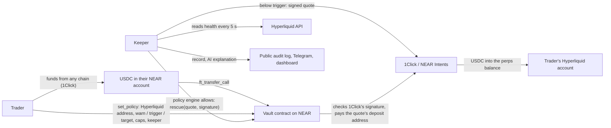

# Lifeline

Auto top-up for onchain perps, funded from any chain.

Lifeline watches a trader's Hyperliquid margin every 5 seconds. When their account health falls below a line they chose, it sends USDC from a reserve they hold on NEAR, through NEAR Intents, into their Hyperliquid perps balance, before liquidation gets close. The reserve can be funded from Ethereum, Solana, Base, Bitcoin and the other chains 1Click supports.

- Dashboard: https://lifeline.prashantthakur.dev (no wallet needed to watch the live demo)
- Keeper API, running the simulation around the clock: https://lifeline-sim.prashantthakur.dev
- Vault contract on testnet: [vault.lifeline-team.testnet](https://testnet.nearblocks.io/address/vault.lifeline-team.testnet)

## Status

Everything below runs today: the keeper, the policy engine, the vault contract (on testnet), the dashboard, the Telegram bot, the AI explanations with attestation, the backtest and both demos. The mainnet vault and the first real rescue with real money are the step still to come. Until then, the hosted keeper runs in simulation mode: its prices and 1Click quotes are real, its positions and settlement are pretend, and the dashboard marks it as the simulation.

## The problem

A leveraged position gets liquidated when its margin runs out, even if the trader has money elsewhere. On 10 October 2025 about $19 billion of positions were liquidated across crypto exchanges in one day ([The Block](https://www.theblock.co/post/374266/crypto-liquidations-near-10-billion-in-historic-drawdown-following-trumps-100-tariffs-on-china)), and Hyperliquid's open interest fell by nearly $9 billion ([The Defiant](https://thedefiant.io/newsletter/defi-daily/the-ultimate-10-10-crash-autopsy)).

Centralised exchanges sell a fix for part of this. Binance has an Auto Top-up switch for isolated margin ([Binance](https://www.binance.com/en/support/faq/0e879254bc9440d5b06c68e97f7c31a1)), and MEXC an Auto Margin Addition for futures ([MEXC](https://www.mexc.com/learn/article/how-to-use-the-auto-margin-addition-function/1)). They work because the exchange holds the backup money. An onchain trader's backup money usually sits on another chain, in another wallet, and nothing moves it in time.

## How it works



1. The trader sets a policy in the vault: their Hyperliquid address, the health levels to warn at, rescue at and refill to, caps per rescue and per day, a cooldown, and the one keeper allowed to act for them.
2. They fund a reserve. The dashboard gets a 1Click quote from whatever token they hold, on any supported chain, into USDC in their own NEAR account, then deposits it into the vault.
3. The keeper reads their health from Hyperliquid every 5 seconds: cross account value divided by maintenance margin. Liquidation comes at 1.0.
4. Below the warn line it alerts them on Telegram. Below the trigger it sizes a rescue to bring health back to the target, gets a live quote from 1Click to the trader's own Hyperliquid perps balance, and runs the policy engine.
5. If the engine allows it, the keeper calls the vault's `rescue` with 1Click's signed quote. The vault checks the signature and every limit itself, then pays the quote's deposit address. 1Click swaps and delivers USDC to Hyperliquid.
6. Every step goes into an append-only audit log, with a plain-language explanation: the facts from the record, and a sentence from a private model on NEAR AI Cloud, running in attested hardware, when the keeper has a NEAR AI key. The hosted demo doesn't have one yet, so its explanations are the facts alone.

## What's built on NEAR

| Piece | What Lifeline uses it for | ID |
| --- | --- | --- |
| Smart contract (Rust, near-sdk 5.30) | The vault: reserves, policies, rescues, on-chain quote checks | testnet [`vault.lifeline-team.testnet`](https://testnet.nearblocks.io/address/vault.lifeline-team.testnet); mainnet to come |
| Function-call access keys | The keeper's only key can call `rescue` on the vault and nothing else: it can't withdraw, transfer or change a policy | testnet [`keeper.lifeline-team.testnet`](https://testnet.nearblocks.io/address/keeper.lifeline-team.testnet) |
| NEAR Intents through the 1Click API | Swaps from any chain into the reserve, and from the reserve into Hyperliquid perps USDC | `https://1click.chaindefuser.com`; Verifier contract `intents.near`; destination asset `1cs_v1:hypercore:hip1:0x6d1e7cde53ba9467b783cb7c530ce054` |
| 1Click's signed quotes, checked on chain | The vault verifies 1Click's Ed25519 signature with `env::ed25519_verify` and reads where the money goes from the signed quote | signer `ed25519:reYaWhvwu8Jzo3WUM3zhn6VrhuMEF4eADL17qtRVifc` |
| NEP-141 fungible tokens | The reserve: native USDC on NEAR, and wNEAR | `17208628f84f5d6ad33f0da3bbbeb27ffcb398eac501a31bd6ad2011e36133a1`, `wrap.near` |
| NEP-145 storage management | The vault registers each fresh 1Click deposit address with USDC before paying it | `storage_deposit` on the USDC contract |
| NEP-297 events | Every deposit, policy change, pause, withdrawal and rescue is logged for indexers and auditors | standard `lifeline`, version 1.0.0 |
| NEAR AI Cloud | Plain-language explanations of each decision, from a private model, with TEE attestation checked through NVIDIA and Intel | `https://cloud-api.near.ai/v1`, model `deepseek-ai/DeepSeek-V4.1-Flash-1017` |
| HOT's near-connect | Wallet connection in the dashboard | `@hot-labs/near-connect` |

## Try it

Each of these needs only Node 22 and pnpm, and no wallet, keys or funds. Clone the repo, then `pnpm install`.

| Do | See |
| --- | --- |
| Open https://lifeline.prashantthakur.dev | The live demo, no wallet: `demo.near`'s health drawn as a sea level against its warn, rescue and liquidation lines. On load the page replays the keeper's last rescue from its log, step by step; every 15 minutes the price drops and the keeper rescues it live. Below: the keeper's stats, the attestation result and the vault's refusal codes |
| `pnpm demo:sim` | The real keeper rescue a pretend position opened at the live ETH price, with a real 1Click quote, the policy engine's verdict and the audit record, in under 30 seconds |
| `pnpm demo:attack` | A hacked keeper's attacks refused by the policy engine, and a real on-chain transaction where the vault refused a redirected rescue, re-checked on a public NEAR node |
| `pnpm --filter intents live-quote 5 0xYourHyperliquidAddress` | A real 1Click quote from NEAR USDC to Hyperliquid perps USDC, its signature checked |
| `pnpm --filter keeper attest` | The NEAR AI model's attestation verified through NVIDIA and Intel with a fresh nonce |
| `pnpm --filter hyperliquid live 0xAnyAddress` | Health, margin and liquidation prices for any Hyperliquid account |
| `pnpm backtest` | `research/backtest/RESULTS.md` and its charts regenerated from the saved candles, in about 15 seconds |
| `pnpm latency` | The keeper's decision time measured against the live APIs, written to `research/latency/RESULTS.md` |
| `pnpm test` | Every test: about 1,300 TypeScript tests, then the vault's 51 unit and 11 sandbox tests |

The vault's Rust tests need [Rust](https://rustup.rs) and `rustup target add wasm32-unknown-unknown`; without them `pnpm test` runs everything else and says so. The first run fetches a local NEAR node for the sandbox tests, and the Rust build needs about 3 GB of free disk.

## Latency

Measured with `pnpm latency` on 8 November 2026, against the vault code that's deployed now ([details and every transaction](research/latency/RESULTS.md)):

| Step | p50 | p95 |
| --- | --- | --- |
| The keeper's decision, against the live Hyperliquid and 1Click APIs (19 of 20 samples; one Hyperliquid read failed) | 1.9 s | 2.5 s |
| The vault's `rescue` transaction, on testnet (10 samples, 2 USDC each) | 4.0 s | 45.0 s |

Nine of the ten transactions took 3.7 to 6.4 s; one took 45 s waiting on the public testnet node, and with ten samples that one is the p95. After the transaction, 1Click has to swap and deliver to Hyperliquid, which its quotes estimate at 30 s. With the keeper looking every 5 s, a rescue would take about 38 s at p50 from health crossing the trigger to USDC on Hyperliquid. The 1Click part is measured on mainnet once a rescue moves real money, and `/api/stats` reports real rescues' p50 and p95 from then on.

## Safety model

A rescue moves a user's money without asking them first, so the question that matters is what happens if the keeper is hacked or simply wrong. Lifeline has two independent layers, and the second one doesn't trust the first.

The first layer is the policy engine in `packages/policy`, a pure function with no network access. It checks every rescue against 16 rules and reports every rule that fails: recipient, refund account, destination asset, pause, per-rescue cap, 24-hour cap, cooldown, whether health is really below the trigger, how old the health reading and quote are, slippage, reserve balance and token. Anything it can't read blocks the rescue. It judges what 1Click answered, not what the keeper asked for, and the keeper checks 1Click's signature on the quote before reading any of it.

The second layer is the vault contract, and it doesn't take the keeper's word for anything. A rescue has to carry the quote 1Click signed, and the vault checks 1Click's signature itself, then reads from the signed quote where the money goes: the deposit address, the Hyperliquid address it pays, the amount, and the account a failed swap refunds. They must match the rescue and the user's policy, and a quote more than 2 minutes old is refused. So a hacked keeper can't pay itself, even with a genuine quote and the right recipient. The vault also checks that the caller is the keeper the user named, that the user hasn't paused, that the amount fits both caps and the reserve, and that the cooldown has passed. If the transfer fails, a callback puts the money back in the reserve.

Changing a policy, unpausing and withdrawing each need 1 yoctoNEAR attached, which only a full-access key can do, so the user's wallet always asks them. A dapp's login key can pause, and nothing else.

The keeper's key can do very little. It's a NEAR function-call key that can call `rescue` on the vault and nothing else, so it can't withdraw, transfer funds or change anyone's policy. Only the user can do those things, and they can pause or withdraw at any time with their own signature. The Telegram bot's `/pause` only links to the dashboard, because the bot can't sign for them.

To watch it work, run `pnpm demo:attack`. It uses real signed 1Click quotes and needs no keys.

| Attack | Refused by |
| --- | --- |
| Pay a genuinely signed quote to the attacker's address | Policy engine: `RECIPIENT_MISMATCH` |
| Send a failed swap's refund to the attacker | Policy engine: `REFUND_MISMATCH` |
| Deliver to HyperEVM, where USDC adds no margin | Policy engine: `WRONG_DEST_ASSET` |
| Drain 1,000 USDC in one rescue | Policy engine: `OVER_PER_RESCUE`, `OVER_DAILY`, `INSUFFICIENT_RESERVE` |
| Rescue while the user has paused | Policy engine: `PAUSED` |
| Rescue again during the cooldown | Policy engine: `COOLDOWN` |
| Rescue a healthy account, to burn its reserve | Policy engine: `NOT_BELOW_TRIGGER` |
| Reuse a stale quote | Policy engine: `QUOTE_STALE` |
| Change a quote's recipient after 1Click signed it | Quote signature check |
| Call `rescue` itself, with the user's real address, a correctly signed quote and its own account as the destination | Vault contract, on chain: `BAD_QUOTE`. Shown on testnet, where the vault trusts a team key in place of 1Click's (1Click has no testnet); the mainnet vault trusts 1Click's key |

The same run allows an honest rescue as a control, so it's clear the engine isn't just refusing everything. The last row is a real failed transaction, signed with the keeper's own restricted key, and the demo asks a public NEAR node about it each time rather than trusting a saved result.

Every warning, rescue, block and failure goes into an append-only audit log, where database triggers refuse any update or delete, and the whole log is public at `/api/ledger`. Before the keeper sends anything, it writes down that it's about to. After a crash or a timed-out send it looks for that rescue's quote ID in the vault's own history before freeing the user for another one, so a lost answer can't turn into a second payment.

The AI has no authority. After each decision, a model on NEAR AI Cloud adds a sentence or two of plain language, and nothing reads those words to decide anything. Each explanation starts with the record's own facts, generated from the record, so a figure on the ledger can't be wrong. The model's words come after them, and they're dropped if they contain a digit or a link, or claim something that didn't happen. The keeper's own notes, like "the money may still arrive", are kept word for word.

Run `pnpm --filter keeper attest` to check that the model runs in secure hardware. It requests a report with a fresh random nonce, checks every GPU through NVIDIA, checks the CPU quote through Intel, and confirms the quote vouches for the signing key, that nonce and the running software. It then does the same for NEAR AI's gateway. We last saw it pass on 8 GPUs with Intel status `UpToDate`. If NVIDIA or Intel can't be reached it says "not available", not "failed", because an outage isn't evidence of anything.

## Backtest results

We ran 18,000 random BTC, ETH and SOL positions through real Hyperliquid 4h candles from 26 July 2024 to 6 November 2026, at 5×, 10× and 20×, long and short, each held for 7 days. Each had $100 of margin and a $50 reserve. The rescue rules are the keeper's own, and a test holds the backtest's rescue size equal to the keeper's real sizing code. `pnpm backtest` regenerates everything from the candles saved in the repo, and two runs give identical output.

These numbers use assumed latency, 35 s and 120 s, until the measured figures replace them.

| Share of positions liquidated | No protection | Lifeline at 35 s | Lifeline at 120 s |
| --- | --- | --- | --- |
| 5× | 6.3% | 2.0% | 2.0% |
| 10× | 30.3% | 14.4% | 14.4% |
| 20× | 66.1% | 45.4% | 45.4% |
| All | 34.2% | 20.6% | 20.6% |


Candles can't show how fast a price moved inside them, so on 4h data almost no rescue is ever too late. That result comes from the data's coarseness, not from Lifeline being fast. To bound it, a second run squeezes each candle's adverse move into one minute, which is harsher than most real markets. Liquidations then come to 29.1% at 35 s and 29.4% at 120 s, against 34.2% unprotected, and 38.4% of rescues arrive too late. At that speed the fall from trigger to liquidation takes seconds, so neither latency gets there first. On 1m candles, the closest we have to real price speed, 2.1% of rescues were too late at 35 s and 4.2% at 120 s, but those cover only 4 days.

Lifeline costs money on average, and you should know that before using it. Across all positions the average result was -$0.15 without it and -$1.14 with it. A saved position finished $68.74 better on average. A position liquidated anyway finished $49.98 worse, because the reserve went with it, and 4,088 of the 18,000 lost more than the fee this way. Rescued positions used $41.86 of their $50 reserve on average. So Lifeline buys survival, not profit. Random entries have no edge, so this test can't show what a saved position earns for a trader who does.

Here's a real case where it failed. A SOL 10× long opened on 5 October 2025 at $232.70. In the crash of 10 October, SOL reached $137.51. Lifeline fired 5 rescues, spent the whole $50 reserve, and the position was liquidated anyway, for a result of -$128.33 against -$76.93 with no protection.

The full report, with the method, stress test, failure cases and how much the answer depends on our choices, is in [research/backtest/RESULTS.md](research/backtest/RESULTS.md).

## Limitations

These are the ones we know about.

- A hacked keeper can still rescue when no rescue is needed. The vault can't see Hyperliquid, so it can't check that health really is below the trigger. The money only ever goes to the user's own Hyperliquid account, within the caps (25 USDC per rescue and 50 USDC per 24 hours by default), and the user can pause or withdraw at any time. Each rescue still pays 1Click's flat fee of about 0.32 USDC, so a keeper firing 2 USDC rescues all day could burn about 8 USDC of fees a day at the default caps. The vault refuses a rescue so small that the fee is more than a fifth of it.
- The vault pays for each rescue's storage, about 0.005 NEAR, from its own balance. A user's 0.05 NEAR registration covers about ten. If the vault account ran out of NEAR, rescues would stop until it's topped up, so its balance needs watching.
- The vault trusts 1Click's signing key, set when the vault is deployed. If 1Click changes its key, rescues stop until the vault is redeployed with the new one. If 1Click's key were stolen, a hacked keeper with it could sign its own quotes.
- You trust the code with your reserve. The vault is a hackathon contract with no audit. A rescue also relies on 1Click and NEAR Intents to deliver, and on Hyperliquid to credit the account.
- The team can replace the vault's code. The vault account keeps its full-access key, so whoever holds that key could deploy a different contract. Deleting the key would make the code permanent; we haven't, because a bug fix would then need a new vault and every user would have to move.
- A rescue takes time, and a crash can be faster. Lifeline looks every 5 s, then has to get a quote, send it and wait for delivery. A price that falls from the trigger to liquidation within that time wins, and the flash-crash test shows how often that could happen.
- A top-up can be lost. It keeps a position open, and if the price keeps falling the reserve goes with it. Each rescue also costs 1Click's flat fee of about 0.32 USDC, and the smallest rescue is 2 USDC, so small rescues lose a large share to the fee.
- Only cross margin is protected. A top-up credits the perps balance and can't reach an isolated position's margin. An account with only isolated positions reads as unknown, never as safe.
- Health is an approximation of Hyperliquid's own calculation. On 5 sampled accounts our formula matched its liquidation price exactly on 2. On the other 3 its price was further away, so health read low and a rescue would fire early, not late. We haven't established why.
- Rescues pay in USDC only. The vault accepts wNEAR deposits, but the caps are in USDC units and don't fit a 24-decimal token, so a wNEAR reserve can't pay for a rescue yet.
- The keeper is one Cloudflare Durable Object. Its alarm wakes it every 5 s, a cron re-arms the alarm if the loop ever stops, and the audit log lives in the object's own storage, so a restart or a deploy loses nothing. If Cloudflare or the object is down, nobody is watching. It picks up unfinished rescues when it restarts, but it can't start one while it's off. It runs on Cloudflare's free plan, whose daily limits it has to share with the public sim: an object that never sleeps uses about 85% of the duration allowance, so the sim sleeps between drops, and the keeper sets one alarm a minute and writes health once a minute to stay well inside the storage limits. `GET /` shows when it last ticked.
- Attestation shows that the hardware and signing key are genuine, not which model is running or that a given explanation came from it. The report's model name isn't signed, the software hash isn't pinned to a known build, and we don't check each answer's signature. It's rechecked every 6 hours. Explanations don't move money, so a wrong one could mislead a reader but can't lose funds.
- Anyone can request a Telegram link code for any watched account, because linking has no proof of ownership yet. A stranger could get a copy of someone's alerts and the owner couldn't remove them, though the same information is public on the ledger. One account can have several chats, so it can't cut off the owner.
- The backtest ignores funding, trading fees and price impact, and each account holds a single position. Real results would be somewhat worse.

## The code

| Folder | What it is |
| --- | --- |
| `contracts/vault` | The vault contract, its tests, and every method with a NEAR CLI example in its README |
| `packages/policy` | The policy engine: a pure function with no network access |
| `packages/intents` | The 1Click client: quotes, signature checks, token list, swap status |
| `packages/hyperliquid` | Reads health, positions and candles from Hyperliquid's API |
| `packages/shared` | Types and constants every part shares |
| `apps/keeper` | The watch loop, rescues, audit log, REST API, AI explanations and attestation; runs in Node or on Cloudflare |
| `apps/bot` | The Telegram bot: one-time linking, alerts, `/status`, `/pause` |
| `apps/web` | The dashboard |
| `research/backtest`, `research/latency` | The backtest and the latency measurements |
| `scripts` | `demo:sim`, `demo:attack`, `latency` |

Running it yourself:

```sh
pnpm --filter keeper sim          # the keeper with a scripted price drop: no wallet, keys or funds
pnpm --filter keeper live         # the real keeper: reads .env (see .env.example); mainnet also needs KEEPER_ALLOW_MAINNET=yes
pnpm --filter web dev             # the dashboard at http://localhost:3000
pnpm --filter keeper cf:dev       # the sim keeper on Cloudflare's runtime, locally
pnpm --filter web cf:dev          # the built dashboard on Cloudflare's runtime
```

`docs/mainnet.md` is the runbook for deploying the vault and keeper to mainnet.

## Licence

MIT
